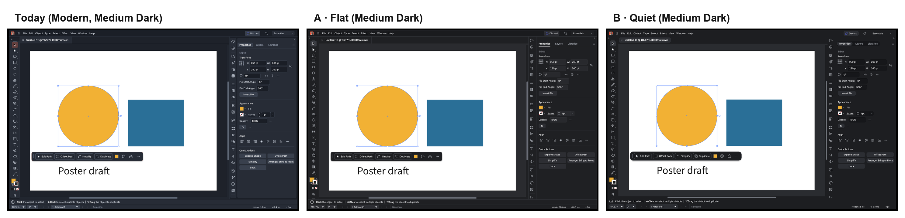
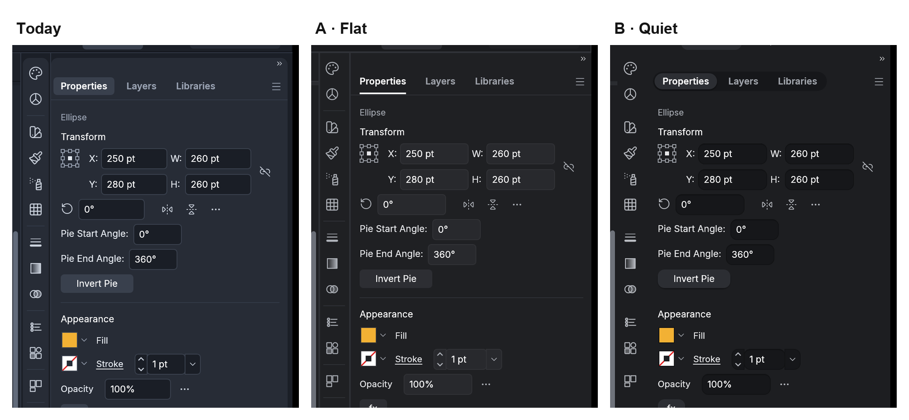
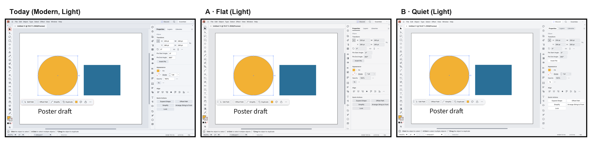

# VectorCraft: a quieter interface — report

A proposal for [VectorCraft](https://github.com/storytold/vectorcraft) by [@Taha-Mahmoodi](https://github.com/Taha-Mahmoodi). It asks the project owner to choose between two designs that replace the 0.12 card look. Both are designed, prototyped, implemented, tested and measured.

| Read | |
|---|---|
| **The argument, one page** | [ARGUMENT.md](ARGUMENT.md) |
| **The research paper** | [paper.pdf](paper.pdf) · [paper.md](paper.md) |
| **The FigCraft prototype** | [figcraft/VectorCraft UI proposal.figcraft](figcraft/) — open in FigCraft, press Present |
| **The code** | branches [`ui/flat-scheme`](https://github.com/storytold/vectorcraft/compare/main...Taha-Mahmoodi:vectorcraft:ui/flat-scheme) and [`ui/quiet-scheme`](https://github.com/storytold/vectorcraft/compare/main...Taha-Mahmoodi:vectorcraft:ui/quiet-scheme) |

## Findings

1. **Container in a container.** `theme::card` draws the toolbar, the panel rail and the dock as rounded cards inside a margin of frame colour, from five call sites. A docked panel is already a region; the card repeats it with two more edges and four corners per panel.
2. **No corner system.** 10 different hard-coded corner radii (0–11 px) in 139 places across 44 files of `ui-egui`; the theme's radius helper `cr()` is called once.
3. **Colour in the chrome.** In Modern, the active tool and selected rows are tinted towards the coral accent and primary buttons are filled with it — colour signals around the artwork all session long.
4. **Users noticed.** #3134 ("VectorCraft and PhotoCraft no longer feel like they belong to the same suite"); #3175 tries to bring the flat 0.11 look back.

Why these matter — common-region grouping, clutter measures, colour-driven attention capture, chromatic induction and the neutral surround of colour-critical viewing, shape scales in design systems — is set out with sources in the [paper](paper.pdf).

## Two proposals, each in Dark and Light

| | A · Flat | B · Quiet |
|---|---|---|
| In one line | Today's look without the cards | Calm and monochrome, soft depth |
| Docked panels | Flush to the window edges, 1 pt dividers | Flush, one continuous surface, no lines |
| Controls | Filled fields and buttons | Inset fields, raised buttons with a soft shadow |
| Panel tabs | Labels with a 2 pt underline | Segmented pill control |
| Active tool | Neutral grey | Neutral raised chip |
| Accent | Blue, for selection, focus, primary action only | Same |
| Corners | 0 / 4 / 8 | 0 / 8 / full / 14 |

FigCraft mockups and design-system sheets: [`mockups/`](mockups/). Real-code renders for every scheme and brightness: [`app/`](app/).

## Measurements (chrome only, real code, 1440 × 900)

| | Edge density (Properties / Layers) | Coloured pixels (Properties / Layers) |
|---|---|---|
| Today · Modern, Medium Dark | 6.35 % / 5.22 % | 0.31 % / 0.47 % |
| A · Flat, Medium Dark | 5.36 % / 4.39 % (−16 %) | 0.18 % / 0.34 % |
| B · Quiet, Medium Dark | 5.02 % / 4.07 % (−21 %) | 0.18 % / 0.33 % |
| Today · Modern, Light | 6.17 % / 4.95 % | 0.18 % / 0.34 % |
| A · Flat, Light | 5.73 % / 4.77 % | 0.18 % / 0.34 % |
| B · Quiet, Light | 5.65 % / 4.70 % | 0.18 % / 0.33 % |

Method and limits: [paper §6](paper.md#6-evaluation); script: [`tools/metrics.py`](tools/metrics.py). These are image proxies, not a user study.

## What's ready

- **Code.** Both designs are new Color Scheme choices; Modern and Classic are untouched. The corner scale is its own commit. "Make it the default" is its own one-line commit on each branch.
- **Tests.** Token tests and headless 1440 × 900 frame tests (flush columns, segmented tabs, no interior dividers).
- **Gate.** `cargo xtask ci` — *all 10 steps passed* on both branch tips (8 812 and 8 814 tests, 0 failures; assets, brands, layers, wasm).
- **Docs.** `docs/ui-parity.md` rows; catalog rows in all 23 languages.

## The decision

1. Take the **corner-scale** commit regardless.
2. Choose the default: **A · Flat**, **B · Quiet**, or keep Modern.
3. Keep the other as an option, or drop it.

Reply on the issue or on Discord; the pull requests open the same day.

## Files

| Path | |
|---|---|
| `ARGUMENT.md`, `paper.md`, `paper.pdf` | The argument and the paper |
| `figcraft/` | FigCraft prototype (pages: Read me, Current, A, B, Overview) |
| `mockups/` | PNGs exported from FigCraft |
| `app/` | Renders of the real code (`kittest-<scheme>-<brightness>-<tab>.png`, canvas rect in the `.json`) |
| `compare-*.png` | Side-by-side figures |
| `tools/` | `build.py` (generates the FigCraft file over FigCraft's control channel), `metrics.py`, `shoot.py`, the offscreen render harness |

Icons are VectorCraft's own (`assets/icons`); font Inter. No third-party artwork. Licensed MIT OR Apache-2.0, like VectorCraft.
