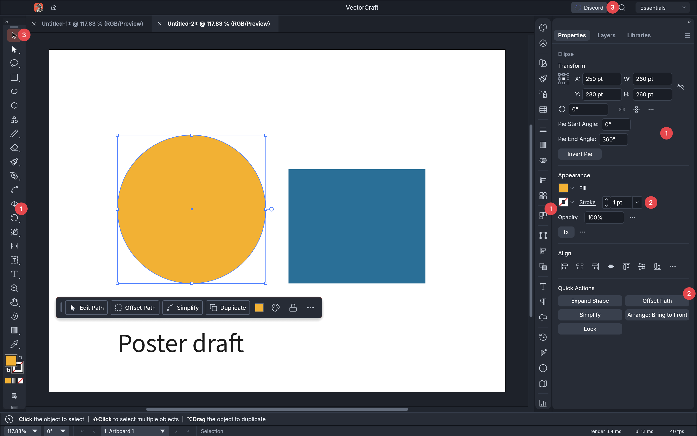
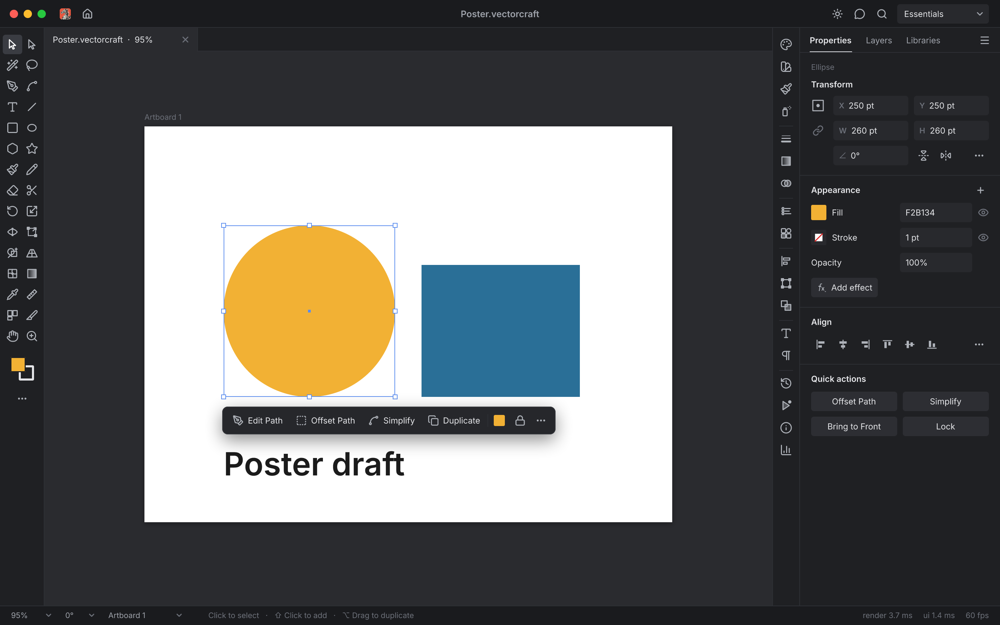
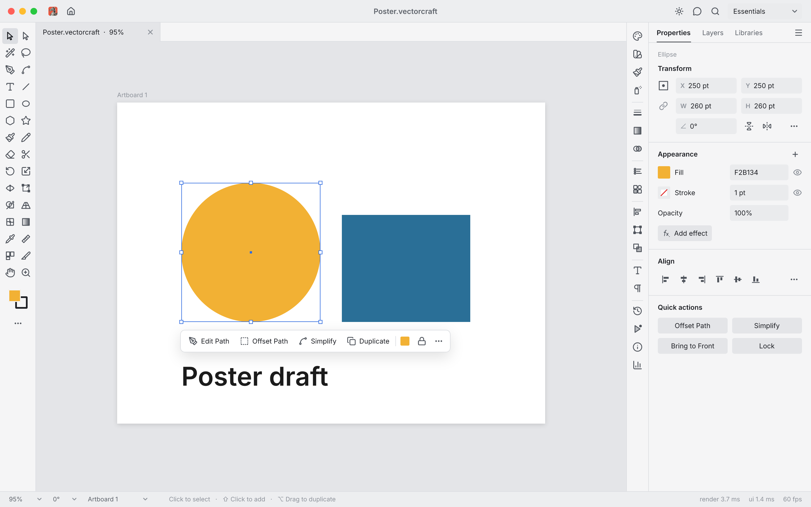
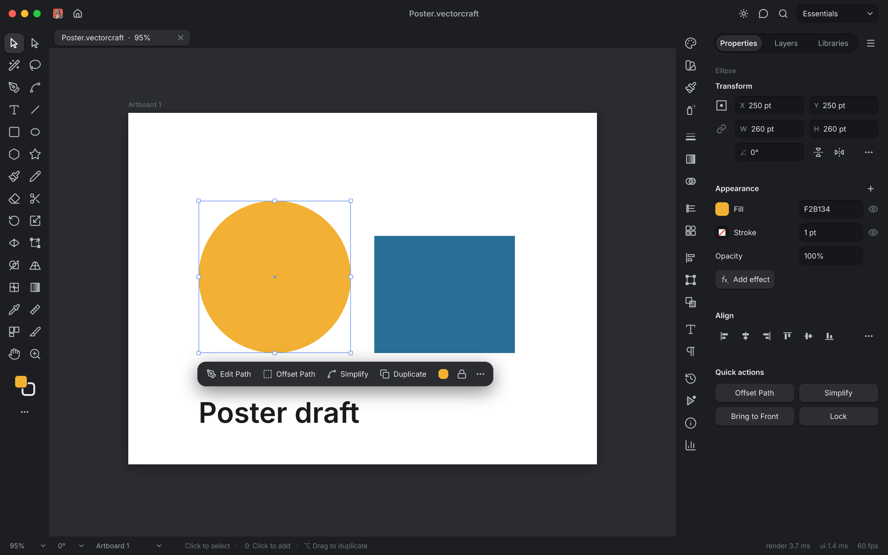
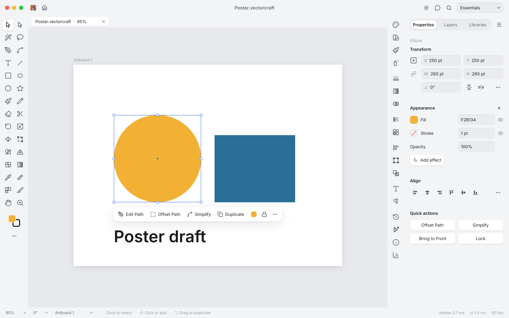
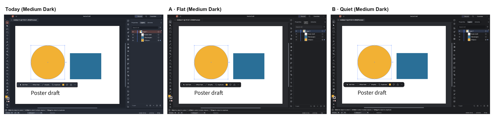

# Quiet Chrome: a neutral, flat interface for VectorCraft

**Taha Mahmoodi** (@Taha-Mahmoodi) · VectorCraft contributor · October 2026

*Proposal paper. Companion files: FigCraft prototype (`VectorCraft UI proposal.figcraft`), mockups (`mockups/`), live screenshots of the real app (`live/`) and offscreen renders (`app/`), ready code on branches `ui/flat-scheme` and `ui/quiet-scheme` of github.com/Taha-Mahmoodi/vectorcraft.*

## Abstract

VectorCraft 0.12 restyled the interface (#2331): the toolbar, the panel rail and the panel dock became rounded *cards* set inside square columns, controls got softer corners, and a coral accent now marks the active tool, selected rows and filled buttons. We argue that for a design tool this look works against its users. Nested containers add edges that carry no grouping information, corner radii no longer follow a system, and a saturated accent competes with the artwork for attention and for colour judgement. We ground each claim in perception research and design-system practice, audit the current code and screenshots, and present two alternatives — **A · Flat** and **B · Quiet**, each in Dark and Light — designed in FigCraft and **already implemented** as opt-in colour schemes that keep Modern and Classic unchanged. On matched screenshots of the running app, both proposals lower the edge density of the chrome by 19–20 % at the default Medium Dark brightness (5–10 % in Light) and cut its coloured pixels by 27–42 % at Medium Dark, with Modern and Classic unchanged. We ask the project owner to choose one of them (or neither) as the default; the code can be opened as pull requests the same day.

## 1 Introduction

A vector illustration tool is used for hours at a time by people whose job is to judge shape and colour. Its interface should recede: the artwork should be the most salient, most colourful thing on screen, and the chrome around it should be quiet, predictable and consistent.

The 0.12 restyle (#2331, merged 2026‑10‑16) moved VectorCraft in the other direction. Users have noticed. Issue #3134 reports that "VectorCraft looks noticeably different from PhotoCraft … the two no longer feel like they belong to the same suite", citing the card toolbar and the flattened panel tabs, and PR #3175 proposes to bring the 0.11 look back as a third colour scheme (held for the owner's decision). This author's own first reaction, as a daily user on macOS, was that the side panels "are round containers inside a square container" and that the interface looks cluttered and unprofessional for a professional design tool.

This paper turns that reaction into an argument that can be checked. Section 2 reviews what perception research and design-system practice say about enclosures, clutter, colour and shape. Section 3 audits the current interface. Section 4 presents two designs; Section 5 their implementation; Section 6 measurements and limits; Section 7 the decision we ask for.

## 2 Background

### 2.1 Enclosure is a grouping cue — nested enclosures repeat it

Palmer showed that elements inside a common bounded region are perceived as a group, a grouping principle as strong as proximity (Palmer 1992; reviewed in Wagemans et al. 2012). A panel docked against the window edge is already a region: it is bounded by the window frame on one side and by the canvas on the other. Drawing a second, rounded region inside it, separated by a strip of frame colour, encodes the same group twice. It adds no information, but it does add contour: two parallel edges and four curved corners per panel, and a band of a third tone between them.

### 2.2 Every extra edge is clutter

Clutter is the state in which excess items or their organisation lead to a degradation of performance at some task (Rosenholtz, Li & Nakano 2007). Rosenholtz et al. propose image-based measures (Feature Congestion, Subband Entropy); they compared these against a simpler proxy, *edge density* — the share of pixels on an edge (Mack & Oliva 2004) — which recurs in later clutter studies (Asher et al. 2013). Redundant outlines, margins and bands raise edge density in the chrome without making anything easier to find.

### 2.3 Colour guides attention

Colour is one of the few attributes that guide visual attention efficiently (Wolfe & Horowitz 2004), and a uniquely coloured item can capture attention even when it is irrelevant to the task (Theeuwes 1992). In a design tool, the task-relevant colour is in the artwork. A saturated accent on the active tool, on selected layer rows and on buttons creates colour singletons in the chrome, at the edges of the field of view, all session long. An accent is still valuable — for selection, focus and the one primary action, where it should capture attention — but its value depends on it being rare.

### 2.4 The surround changes the colour you see

The colour an observer perceives in a region depends on the colours around it (chromatic induction; reviewed by Shevell & Kingdom 2008). Colour-critical work therefore controls the surround: the standard for soft-proofing displays defines the *surround* as the "area adjacent to the border of an image, which, upon viewing the image, may affect the local state of adaptation of the eye", and asks that "no strongly coloured surfaces … should be present in the immediate environment surrounding the monitor" (ISO 12646:2008, §3.1.15 and §4.7.1). The standard speaks of the room, not of application chrome; but the same mechanism applies to the coloured pixels next to the artwork on the screen itself. A neutral chrome is the on-screen analogue of the neutral surround.

### 2.5 Shape is a scale, not a set of choices

Mature design systems express corner roundness as a small, named scale — Material Design 3 defines corner tokens from *none* through *extra small*, *small*, *medium*, *large* to *full* (Material Design 3, "Shape: corner radius scale") — so that the same kind of thing always has the same corner. When radii are picked per widget, nearby elements disagree by one or two pixels, which reads as carelessness rather than intent.

### 2.6 Flat must keep its signifiers

Flat design has a known failure mode: weak signifiers make interactive elements harder to recognise and slower to use (Moran 2017). "Flat chrome" here means no decorative containers — not unlabelled, borderless controls. Both proposals keep filled fields and buttons; B adds a subtle raised/inset treatment to make clickable things clearer still.

### 2.7 Dark and light both have a place

Dark text on a light background (positive polarity) improves reading performance, especially for small text (Piepenbrock et al. 2013, 2014), while many artists prefer a dark surround for image work. Each proposal therefore comes in Dark and Light, mapped onto VectorCraft's four brightness levels.

## 3 Audit of the current interface (main @ cb0a7d9b)

**Cards.** `theme::card` (`crates/ui-egui/src/theme.rs`) draws "the toolbar, the panel dock and the icon rail" as cards: the body on the panel colour with soft corners (`CARD_RADIUS = 8`), inside a margin of the window's frame colour. It is called from five places (`toolbar.rs`, `dock.rs` ×2, `panel_docking.rs` ×2). Every docked surface is therefore a container inside a container.

**Corners.** The interface uses 10 distinct hard-coded corner radii (0, 1, 2, 3, 4, 5, 6, 8, 10 and 11 px; 139 uses) across 44 source files of `ui-egui`. The theme has a radius token (`Tokens::radius = 4`), but its helper `Tokens::cr()` is called in one place; everything else picks its own number. Window and menu corners are set separately (10 and 8 px).

**Accent.** In the default Modern scheme, `Tokens::with_accent` tints the active tool 30 % and selected rows 24 % towards the accent (coral by default) and fills primary buttons with it. The result is visible in every screenshot: a coral tool button top-left, coral-tinted layer rows, coral buttons in dialogs.

**Screenshots.** Figure 1 marks the three problems on a 0.13.1 window.

## 4 Two proposals

Both proposals follow four rules:

1. **Nothing docked is a card.** The toolbar, rail and dock reach the window's edges.
2. **One corner scale, from tokens.** No hand-picked radii in the chrome.
3. **Neutral chrome.** The accent marks selection, focus and the primary action only; the active tool is a neutral grey.
4. **Shadows only on what floats** — the contextual task bar, menus, popovers, dialogs.

Layout, tool set and panel contents are unchanged.

| | A · Flat | B · Quiet |
|---|---|---|
| Idea | Today's look without the cards | Calmer, after soft monochrome interfaces |
| Separation | Tone + 1 px hairlines | Tone + space; no lines inside the chrome |
| Controls | Filled fields and buttons | Inset fields, raised buttons (soft shadow) |
| Panel tabs | Text with 2 px underline | Segmented pill control |
| Corners | 0 / 4 / 8 | 0 / 8 / full / 14 |
| Modes | Dark, Light | Dark, Light |

The FigCraft file contains, for each proposal, a design-system sheet (colour tokens as FigCraft variables with Dark and Light modes, the corner scale, type, controls, rules) and Properties and Layers screens in both modes, wired as a clickable prototype (panel tabs; the sun button switches Dark and Light).

## 5 Implementation

The designs are implemented in VectorCraft itself, so the decision is about direction, not effort.

Both designs are implemented as additional choices under **Preferences › User Interface › Color Scheme**, next to Modern and Classic, on top of current `main` (cb0a7d9b). Each branch ends with a separate one-line commit that makes it the default, so the scheme can be taken without the default change.

**Branch `ui/flat-scheme`** (github.com/Taha-Mahmoodi/vectorcraft, 5 commits, 71 files, +527 / −167):

| Commit | What it does |
|---|---|
| `5484e755` | **One corner scale.** Three tokens — `radius` 4 (controls, `cr()`), `radius_small` 2 (swatches, chips, check boxes, `cr_small()`), `radius_float` 8 (menus, popovers, dialogs, windows, `cr_float()`) — replace 139 hard-coded radii in 44 files. `CARD_RADIUS` is gone. The only literals left are 6 handle and glyph drawings. Modern and Classic keep 4 / 2 / 8, so they barely move. |
| `b87dac7f` | **Flat scheme.** Tokens for all four brightness levels; two reusable token switches: `cards` (off: `theme::card` fills the column edge to edge with a 1 pt divider on its inner side) and `tab_style` (`Underline`). The pressed tool is neutral grey; the blue accent ignores Accent Color. Catalog rows in every language. |
| `58704347` | Tests: Flat's tokens, one corner scale for every scheme, and a headless 1440 × 900 frame proving Flat's toolbar and dock reach the window edges while Modern keeps its cards. |
| `ccf3c441` | `docs/ui-parity.md` records the scheme. |
| `4d5aff0f` | Flat becomes the default (separate, optional). |

**Branch `ui/quiet-scheme`** (built on Flat's first four commits):

| Commit | What it does |
|---|---|
| `936e8c0c` | **Quiet scheme.** More reusable switches: `TabStyle::Segmented` (pill track, raised chip), `chrome_lines` (off: no lines inside the chrome), `raised_shadow` (soft shadow under buttons, the active tool, selected icon buttons and tab chips; `theme::paint_raised`), `field_shade` (inset number fields; `theme::paint_inset`), corners 4 / 8 / 14 / full. App bar, panels and tab strips share one surface. |
| `60b5f2af` | Tests: Quiet's tokens, and a headless frame proving segmented dock tabs and line-free flush columns. |
| `6e6b1bf7` | `docs/ui-parity.md` records the scheme. |
| `1d19ef07` | Quiet becomes the default (separate, optional). |

**Quality gate.** `cargo xtask ci` passes end to end on both branch tips — *"CI summary: all 10 steps passed (fmt, clippy, test, no-bundled-fonts, pdf-deps, assets, brands, cursors, layers, wasm)"*: 8 812 tests on Flat, 8 814 on Quiet, 0 failures; 328 assets attributed; 28 crates without layering violations; all 23 wasm crates check.

**Known differences from the mockups (Quiet).** egui draws only outer shadows, so inset fields are a darker fill with a shade along the top edge; native egui buttons and combo boxes get the colours but not the shadow; small marks keep 4 pt corners (at 6 pt a 13 pt check box reads as a radio button); the status and hint bars stay two bars. None of these change the argument.

## 6 Evaluation

**Method.** We built the same document (a yellow circle, a blue rectangle and the text "Poster draft", with the circle selected) in a fresh window of each build, resized it to 1440 × 900 points, and took screenshots of the live window (Retina, 2×) through the app's control channel (`ui.screenshot`), on the Properties and Layers tabs. *Today* is the released VectorCraft 0.14.0 (Modern scheme, as shipped); A and B are the proposal branch, built in release mode. We measured the *chrome* — every pixel outside the canvas rectangle the app reports — for (a) **edge density**, the share of pixels where the Sobel gradient of CIELAB L\* exceeds 8 per pixel (Mack & Oliva 2004), and (b) **chromatic share**, the share of pixels with CIELAB chroma C\*ab > 15. Scripts: `tools/shoot.py` and `tools/metrics.py`; screenshots and canvas rectangles: `live/`.

| Live screenshot | Edge density, Properties | Edge density, Layers | Chromatic share, Properties | Chromatic share, Layers |
|---|---:|---:|---:|---:|
| Today · 0.14.0 Modern, Medium Dark | 6.25 % | 5.05 % | 0.33 % | 0.49 % |
| A · Flat, Medium Dark | 5.07 % (−19 %) | 4.05 % (−20 %) | 0.19 % (−42 %) | 0.36 % (−27 %) |
| B · Quiet, Medium Dark | 5.06 % (−19 %) | 4.07 % (−19 %) | 0.19 % (−42 %) | 0.35 % (−29 %) |
| Today · 0.14.0 Modern, Light | 5.42 % | 4.13 % | 0.19 % | 0.36 % |
| A · Flat, Light | 4.93 % (−9 %) | 3.92 % (−5 %) | 0.19 % | 0.36 % |
| B · Quiet, Light | 4.87 % (−10 %) | 3.86 % (−7 %) | 0.19 % | 0.35 % |

*Chrome = all pixels outside the canvas rectangle (≈ 2.0 million pixels per screenshot). Screenshots of every scheme at all four brightness levels are in `live/`; offscreen renders of the same code (egui_kittest, `app/`) show the same direction.*

**Reading the numbers.** Removing the cards and the frame bands removes edges, so edge density falls in every case, most at Medium Dark, where today's cards sit on a much darker frame colour; in Light the cards are low-contrast already, so the gain is smaller. In the live window A and B measure almost the same: Quiet's missing divider lines are offset by its pill tabs and shadows. The coloured-pixel share at Medium Dark falls because the active tool and selected rows are no longer tinted with the accent; what remains in every build is the selected object's fill swatch and the Discord button. Modern at Light uses a light accent tint that falls under the chroma threshold, so it measures the same as the proposals there.

**Limits.** These are image proxies, not a user study. Edge density depends on content (the Layers tab differs per build in row styling), and today's build (0.14.0) is a little newer than the proposal branch's base, though nothing in the measured chrome differs between them except the scheme; chromatic share is small in every build because the accent covers few pixels — its cost is salience (Section 2.3), not area. A short preference test with community members (both proposals installed side by side via the Color Scheme preference) would settle what the measurements cannot.

## 7 Decision requested

1. **Merge the corner-scale commit regardless.** It changes nothing visible in Modern or Classic beyond aligning stray radii, and gives every future style one place to change.
2. **Choose a default:** A · Flat, B · Quiet, or keep Modern. A is the smaller visual change; B is the larger step towards a calm, distinctive Craft look.
3. **Keep or drop the opt-in schemes.** Both are separate commits; the "make it the default" change is its own commit, so any combination can be taken.

If #3175 (Classic OG) lands, A covers most of its intent (flat panels, real tabs) while keeping the 0.12 layout and fonts, so the two can be reconciled.

## References

- Asher, M. F., Tolhurst, D. J., Troscianko, T., & Gilchrist, I. D. (2013). Regional effects of clutter on human target detection performance. *Journal of Vision*, 13(5). https://jov.arvojournals.org/article.aspx?articleid=2121669
- ISO 12646:2008. *Graphic technology — Displays for colour proofing — Characteristics and viewing conditions*, §3.1.15, §4.7.1. https://www.iso.org/standard/44468.html (superseded by ISO 12646:2015).
- Mack, M. L., & Oliva, A. (2004). Computational estimation of visual complexity. *Proceedings of the 12th Annual Object, Perception, Attention, and Memory Conference*.
- Material Design 3. Shape — corner radius scale. https://m3.material.io/styles/shape/corner-radius-scale
- Moran, K. (2017). Flat UI elements attract less attention and cause uncertainty. Nielsen Norman Group. https://www.nngroup.com/articles/flat-ui-less-attention-cause-uncertainty/
- Palmer, S. E. (1992). Common region: A new principle of perceptual grouping. *Cognitive Psychology*, 24(3), 436–447. https://doi.org/10.1016/0010-0285(92)90014-S
- Piepenbrock, C., Mayr, S., Mund, I., & Buchner, A. (2013). Positive display polarity is advantageous for both younger and older adults. *Ergonomics*, 56(7), 1116–1124. https://doi.org/10.1080/00140139.2013.790485
- Piepenbrock, C., Mayr, S., & Buchner, A. (2014). Positive display polarity is particularly advantageous for small character sizes. *Human Factors*, 56(5), 942–951. https://doi.org/10.1177/0018720813515509
- Rosenholtz, R., Li, Y., & Nakano, L. (2007). Measuring visual clutter. *Journal of Vision*, 7(2):17, 1–22. https://doi.org/10.1167/7.2.17
- Shevell, S. K., & Kingdom, F. A. A. (2008). Color in complex scenes. *Annual Review of Psychology*, 59, 143–166. https://doi.org/10.1146/annurev.psych.59.103006.093619
- Theeuwes, J. (1992). Perceptual selectivity for color and form. *Perception & Psychophysics*, 51(6), 599–606. https://doi.org/10.3758/BF03211656
- Wagemans, J., et al. (2012). A century of Gestalt psychology in visual perception I. *Psychological Bulletin*, 138(6), 1172–1217. https://pmc.ncbi.nlm.nih.gov/articles/PMC3482144/
- Wolfe, J. M., & Horowitz, T. S. (2004). What attributes guide the deployment of visual attention and how do they do it? *Nature Reviews Neuroscience*, 5(6), 495–501. https://doi.org/10.1038/nrn1411
- VectorCraft: PR #2331 (UI: restyled interface), issue #3134, PR #3175. https://github.com/storytold/vectorcraft
